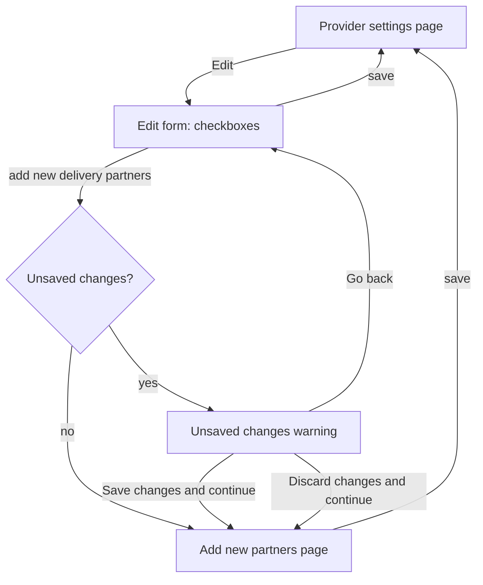

# Delivery partnerships

A `DeliveryPartnership` links a `DeliveryPartner` to a `LeadProvider` for a `Course`
(unique on that triple). Lead providers may only record a delivery partner on a
declaration if an **active** partnership exists.

## Archiving

Partnerships are archived, never deleted (see
[ADR 0001](../decisions/0001-archive-delivery-partnerships.md)).

```ruby
DeliveryPartnership.active      # archived_at IS NULL
DeliveryPartnership.archived    # archived_at IS NOT NULL
partnership.archive!            # sets archived_at
partnership.unarchive!          # clears archived_at
partnership.archived?
```

| Area | Effect of archiving |
|------|---------------------|
| `GET /api/v1/delivery-partners` and `/{id}` | Partnership is left out. A partner with no active partnership for the lead provider is not listed; `show` returns not found. `archived_at` is never exposed. |
| Declaration create / change delivery partner | Rejected with the existing "not available" validation error. |
| Existing declarations | Unchanged. Still returned by the API and admin with the partner name, can be voided and appear in statements (validation only runs when the partner changes). |
| Admin lists (settings course and provider pages, course cohorts, lead provider page) | Active partnerships only. |
| Model associations (`LeadProvider#delivery_partners`, `DeliveryPartner#lead_providers`, `Course#delivery_partners`, ...) | Active only. Query `DeliveryPartnership` directly for archived rows. |

`archived_at` is included in `config/analytics.yml`.

## Audit trail

`DeliveryPartnership` and `DeliveryPartner` use `has_paper_trail` (ignoring `updated_at`).
Create, archive, unarchive and destroy each write a row to `versions`. In the admin console
`whodunnit` is `AdminUser <id>`; console, jobs and rake tasks use their own existing values.

Archive/unarchive/create always go through model callbacks (no `update_all` or `insert_all`),
otherwise versions would be lost. History is recorded only; there is no admin UI to view it.

## Editing (super admin only)

Entry point: **Edit** next to "Delivery partners" on
`/admin/settings/courses/:course_id/providers/:id`. Non-super-admins are refused on every step.



### Edit form

- Two alphabetical (case-insensitive) groups: partners with an active partnership (checked),
  then all others (unchecked).
- Checking creates a partnership, or unarchives an existing archived one. Unchecking archives it.
- All changes save in one transaction (`DeliveryPartnerships::Update`).
- **At least one active partnership** must remain. Unchecking everything shows
  "Select at least one delivery partner" with selections preserved. This is enforced server-side
  with row locks, so crafted or concurrent requests cannot empty the list.
- Unknown delivery partner IDs are ignored. `DeliveryPartner` records are never removed.

### Add new delivery partners

- Free-text name inputs. **Add more** works without JavaScript: it posts the page, and the
  server re-renders it with values kept and one extra input (nothing saved, no errors).
- Saving creates each `DeliveryPartner` plus an active partnership, in one transaction
  (`DeliveryPartnerships::CreatePartners`). Names are trimmed.
- Errors (nothing saved): all blank ("Enter a delivery partner name"); name matches an existing
  partner (case-insensitive; select it on the edit form instead); duplicate name within the form.

### Unsaved changes warning

The **add new delivery partners** button submits the checkbox form. If selections differ from
saved state (`DeliveryPartnerships::PendingChanges`), a warning page lists pending additions and
removals with: *Save changes and continue*, *Discard changes and continue*, *Go back* (returns
to the form with unsaved selections kept in hidden fields). No JavaScript required.

## Code locations

| Path | Purpose |
|------|---------|
| `app/models/delivery_partnership.rb` | Scopes, archive helpers, PaperTrail |
| `app/controllers/admin/settings/courses/providers/delivery_partnerships_controller.rb` | Edit form, warning page |
| `app/controllers/admin/settings/courses/providers/delivery_partners_controller.rb` | Add new partners page |
| `app/services/delivery_partnerships/{update,create_partners,pending_changes,query}.rb` | Edit logic; API query |
