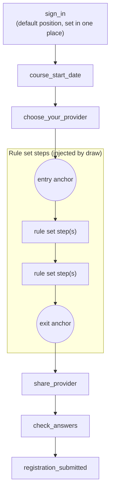
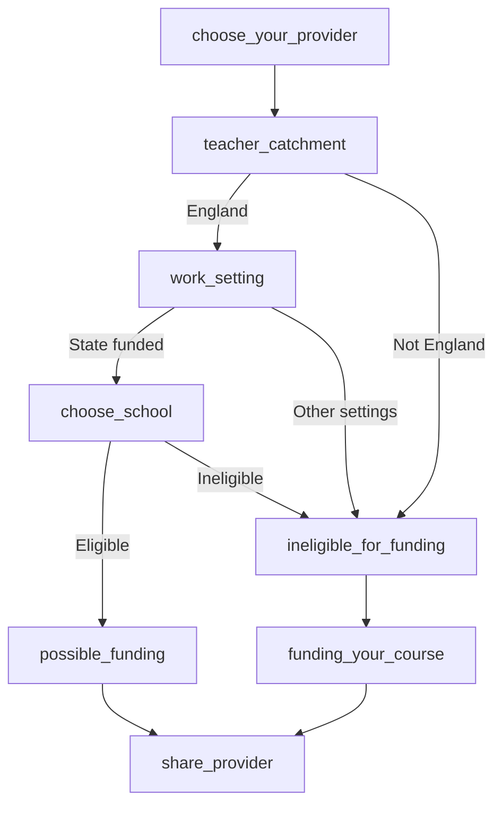

# ADR 001: Registration journey on dfe-wizard with pluggable funding eligibility rule sets

- **Status:** Accepted
- **Scope:** Registration journey (`/registration/...`)

## Context

The registration journey is built on a custom engine: `RegistrationWizard`
(`app/models/registration_wizard.rb`) and one `Questionnaires::*` class per step
(`app/forms/questionnaires/`). Each step hard-codes its `next_step` and
`previous_step`, and the funding rules live in `FundingEligibility`
(`app/services/funding_eligibility.rb`), which is tied to the state funded
school journey.

The service now needs to offer several courses. Each course has its own funding
eligibility rules and therefore its own extra questions. The engine cannot do
that without more branching inside every step. The admin course builder already
uses the `dfe-wizard` gem (`app/wizards/admin/course_builder/`), which gives a
step graph, route strategies, state stores and check answers support.

This ADR records the contract that the follow-up tickets in the
`registration-wizard` epic implement. No application code changes with it.

## Decisions

### 1. The course is selected before the wizard starts

**Decision.** The teacher picks a course before the wizard starts, in one of two
ways:

- a course selector page, open to everyone, listing every open course;
- a deep link `/registration/:course_identifier` from an external landing page.

The course is part of every wizard URL: `/registration/:course_identifier/:step`.
Once selected, the course cannot be changed from inside the journey, including
from check answers. To change course, the teacher starts again from the selector.

**Options considered.**

| Option | Verdict |
|--------|---------|
| Course as the first wizard step, kept in state | Rejected. The graph depends on the course (rule set steps), so it cannot be built before the first answer. Check answers would need to rebuild the graph when the course changes, invalidating answers. |
| Course stored only in the session | Rejected. The wizard cannot be rebuilt from the URL alone, deep links need a redirect, and two tabs on different courses would clash. |
| **Course in the URL** | **Chosen.** The wizard is rebuilt identically on every request from the URL. Deep links and bookmarks work. |

### 2. Funding eligibility rule sets are Ruby classes in a registry

**Decision.** A funding eligibility rule set is a Ruby class registered in a
code registry. `courses.funding_eligibility` stores the registry key. Admins pick
a key from the list of available rule sets. A rule set can be shared by many
courses.

**Options considered.**

| Option | Verdict |
|--------|---------|
| Rules and questions configured in the database (admin editable) | Rejected. Rules need conditions, lookups (institution, previous funding) and their own screens. A configuration language would be a worse version of Ruby, and untestable by a normal spec. |
| One `if course == ...` branch per course in the wizard | Rejected. Does not scale and cannot be shared between courses. |
| **Ruby classes with a registry, key stored on the course** | **Chosen.** Reviewed and tested like code, shareable, and the admin choice stays a simple select. |

An unknown key stored on a course (for example after a rule set is removed) must
fail loudly when the graph is built, not fall back silently.

### 3. Rule set contract

Every rule set exposes:

| Method | Purpose |
|--------|---------|
| `key`, `name` | Registry key stored on the course, and the label shown to admins |
| `draw(graph, entry:, exit:)` | Adds the rule set's steps and edges to the shared graph between two anchors |
| `evaluate(state_store)` | Returns the funding eligibility result code. Values are compatible with the existing `applications.funding_eligibility` strings (`funded`, `not_in_england`, `previously_funded`, `ineligible_setting`, `marked_ineligible_by_policy`) |
| `check_answer_rows(presenter)` | Adds the rule set's rows to check answers |
| `submission_attributes(state_store)` | Returns `funding_eligibility` and `funding_choice` for the new application |

The shared wizard knows nothing about a rule set's steps. It only knows the two
anchors.

### 4. Shared graph

The rule set may branch between the anchors, but every path must reach `exit`.

### 5. Authentication is a wizard step

**Decision.** Authentication becomes a wizard step, `sign_in`, instead of a
controller guard. Its position is defined in one place so it can move later. The
default position stays first, which is today's behaviour.

Policy intends a future journey where teachers check funding eligibility without
signing in, then sign in and finish. Each step therefore declares whether it needs
a signed-in teacher. Building the graph fails if a step that needs a signed-in
teacher comes before `sign_in`.

**Options considered.**

| Option | Verdict |
|--------|---------|
| Keep a controller guard (`before_action`) | Rejected. Blocks any anonymous step, and the position of sign-in is hidden outside the graph. |
| **`sign_in` as a graph step with a per-step `requires_user` declaration, validated at build time** | **Chosen.** Position is explicit, and an unsafe move is caught when the graph is built, not by a user. |

**Current steps that depend on the user, and block moving `sign_in` later:**

- **Previously funded check.** `FundingEligibility#previously_funded?` finds
  accepted, funded applications by the signed-in user's TRN or One Login ID.
  Any step that decides on it (`choose_school`, `ineligible_for_funding`) needs
  the user.
- **"Later" notification flag.** `Questionnaires::CourseStartDate` updates
  `current_user.notify_user_for_future_reg` when the teacher picks a later start.
  That write needs the user.
- **One application per course cohort check** (see decision 8).

Moving `sign_in` later therefore needs these rewritten first (for example by
deferring the previously funded check and the flag write to after sign-in).
That work is out of scope here.

### 6. Course start date is never skipped

The `course_start_date` step is always in the graph. A start date in the past
shows a hint to the teacher; it does not skip or block the step.

### 7. State

**Decision.** State is stored with `DfE::Wizard::Repository::Session`, with one
state key per course. Answers to different courses do not overwrite each other.
Attributes stay flat (not namespaced per step), so **rule set attribute names
must be unique across the whole wizard**, shared steps included. Registering a
rule set whose attribute names collide must fail when the graph is built.

**Options considered.** A database-backed repository was rejected: no need to
persist half-finished journeys and it adds cleanup work. A single session key
for all courses was rejected because answers leak between courses.

### 8. One application per course cohort

A teacher may have only one application per course cohort (course plus
registration period), whatever its status. This is enforced by the existing
unique index `index_applications_on_user_id_and_course_cohort_id`. The wizard
checks it once the teacher is signed in **and** has chosen a start date (which
resolves the course cohort), wherever `sign_in` sits in the graph. The index
stays the final guard.

### 9. Migration: strangler behind a feature flag

The new journey is built next to the legacy one, behind a feature flag
(`Feature`, `app/services/feature.rb`). Both run side by side until the new
journey reaches parity, then the legacy `RegistrationWizard`, `Questionnaires::*`
and the flag are removed.

**Options considered.** A big-bang replacement was rejected as too risky for a
live journey and impossible to roll back. Running two journeys indefinitely was
rejected because of the double maintenance.

## Worked example: `StateFundedSchool`

The current journey becomes the first rule set, `StateFundedSchool`. It owns the
steps below. They exist today as `Questionnaires::*`.

| Step | Today | Becomes |
|------|-------|---------|
| `teacher_catchment` | England or not. Not England goes to `ineligible_for_funding` | Entry step. Not England branches to `ineligible_for_funding` |
| `work_setting` | State funded institution continues. Others go to `ineligible_for_funding`. Clears `funding` and `institution_id` on save | Same branch. Clears the same keys |
| `choose_school` | Institution search. Ineligible (not England, not an eligible establishment, previously funded) goes to `ineligible_for_funding` | Same |
| `possible_funding` | Funded. Stores `funding_amount` | Same. Leads to the exit anchor |
| `ineligible_for_funding` | Shows a template per status code (`not_in_england`, `previously_funded`, `ineligible_setting`) | Same, templates chosen from `evaluate` |
| `funding_your_course` | Asks who pays (`school`, `trust`, `self`, `another`, `employer`). Leads to `share_provider` | Same. Leads to the exit anchor |

Contract mapping:

- `draw`: adds the six steps and the edges above, from `entry` (before
  `teacher_catchment`) to `exit` (before `share_provider`).
- `evaluate`: wraps the existing `FundingEligibility` logic and returns its codes.
- `check_answer_rows`: rows for `teacher_catchment`, `work_setting`, the school
  and `funding`.
- `submission_attributes`: `funding_eligibility` from `evaluate`, and
  `funding_choice` from the `funding` answer.

## Consequences

- A new course with a known rule set needs no code. A new rule set is one class
  and its steps, tested on its own.
- The URL carries the course, so every request rebuilds the same graph.
- Moving `sign_in` later is possible but needs the user-dependent steps reworked
  first (decision 5).
- Flat attribute names constrain rule set authors (decision 7).

## Known risks

1. **Users mid-journey at cut-over lose their answers.** The legacy journey
   keeps its state in a different shape and a single key, and the new one uses
   one key per course. Answers are not migrated. Mitigation: cut over outside
   peak registration times, and tell users on the start page. Accepted.
2. **`registration_data` keys must stay stable for analytics.**
   `HandleSubmissionForStore` saves the whole store (minus session keys) into
   `applications.registration_data`, which the analytics team consumes. The new
   journey must write the same keys with the same values, for example
   `teacher_catchment`, `work_setting`, `institution_id`, `funding`,
   `funding_amount`, `course_start_date`. Adding keys needs analytics review;
   renaming or removing them is not allowed without it.
3. **Parity gaps while both journeys run.** Fixes to the legacy journey must be
   mirrored until it is removed.
4. **Attribute name collisions** between rule sets, see decision 7.
