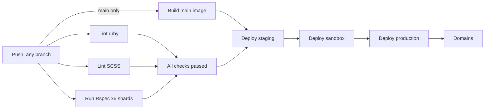

[< Back to overview](overview.md)

# Specs and Linting

A practical guide to running tests and linters.

- [Quick reference](#quick-reference)
- [Running tests](#running-tests)
- [Test config](#test-config)
- [Common patterns](#common-patterns)
- [Linting](#linting)
- [CI](#ci)
- [Coverage](#coverage)
- [Key files](#key-files)

---

## Quick reference

```bash
bundle exec rake               # rubocop → scss-lint → rspec
bundle exec rspec              # full suite
bundle exec rspec spec/models/user_spec.rb         # single file
bundle exec rspec spec/models/user_spec.rb:38      # single example
bundle exec rubocop -a         # safe auto-correct
bundle exec rubocop -A         # all auto-correct
```

---

## Running tests

### Full suite

```bash
bundle exec rspec
```

Random order. Failed examples persist to `.examples` (`--only-failures`).
RSpec uses `doc` formatter for single-file runs.

Filter by tag (`:npq` and `:revisit` excluded by default):

```bash
bundle exec rspec --tag ~npq
```

### Parallel (local)

```bash
bundle exec rake parallel:setup   # one-time
bundle exec rake parallel:spec
```

---

## Test config

**`spec/spec_helper.rb`** — Knapsack bind, SimpleCov start (`"rails"` preset),
WebMock (external HTTP blocked except localhost + edgedl), random order,
`:npq`/`:revisit` exclusion, `.examples` persistence.

**`spec/rails_helper.rb`** — transactional fixtures, FactoryBot syntax methods,
`Course::IDENTIFIERS` pre-created, `Flipper.enable(REGISTRATION_OPEN)`, Cuprite
driver (Chrome headless, `default_max_wait_time: 10`, `1400x1400`),
`capybara-screenshot` on failure, Shoulda Matchers, PaperTrail, feature specs in
`"London"` time zone, RSwag dry run disabled.

**Testing gems:** `rspec-rails`, `factory_bot_rails`, `faker`,
`shoulda-matchers`, `capybara` + `cuprite`, `capybara-screenshot`, `site_prism`,
`webmock`, `axe-core-capybara` + `axe-core-rspec`, `simplecov`, `knapsack`,
`parallel_tests`, `rspec-sonarqube-formatter`, `rswag-specs`.

---

## Common patterns

```ruby
# FactoryBot — pre-created courses, traits in spec/factories/
create(:application, :accepted, :with_school)
let(:course) { Course.find_by(identifier: "npq-headship") }

# Shoulda matchers — one-liners + negated helper
it { is_expected.to have_many(:applications).dependent(:destroy) }
expect { action }.to not_change(Application, :count)

# Request specs — shared examples, auto-included helpers
RSpec.describe "Participants", type: :request do
  it_behaves_like "an API index endpoint"
end

# Accessibility
expect(page).to be_axe_clean

# RSwag — generate OpenAPI spec
# bundle exec rspec spec/requests/api/docs/ --format RSwag::Formatters::SwaggerFormatter
```

---

## Linting

### RuboCop

Config inherits from `.rubocop_todo.yml`, `config/rspec-rswag.yml`, and
`rubocop-govuk` (default, rails, rspec presets).

```bash
bundle exec rubocop              # check only
bundle exec rubocop -a           # safe auto-correct
bundle exec rubocop -A           # all auto-correct
bundle exec rake lint:ruby       # via Rake (clang + auto-correct)
bundle exec rake lint:scss       # SCSS via scss_lint-govuk
```

---

## CI

Tests and lint run **once per branch push**, owned by
`.github/workflows/rspec.yml` (workflow name **CI and deploy**, `push` on every
branch, including `main`). Pull requests start no suite of their own; they show
the push checks for the PR head commit. `deploy.yml` (PR review apps) does not run
tests or lint.



| Job (display name)  | Runs                                                            |
|---------------------|-----------------------------------------------------------------|
| `Lint ruby`         | `bundle exec rubocop`                                           |
| `Lint SCSS`         | `bundle exec rake lint:scss`                                    |
| `Run Rspec (6, N)`  | 6 Knapsack shards (N = 0-5) = one suite; Postgres, Ubuntu 24.04 |
| `All checks passed` | Always runs; succeeds only if every needed job succeeded        |

`All checks passed` uses `if: always()` and fails for failed, cancelled or skipped
needs. It is the single check to require on pull requests. Coverage and test
reports are uploaded per shard.

### Main deployment (same workflow)

Pushes to `main` additionally run, in the same run:

- `Lead Provider OpenAPI Check` (not part of `All checks passed`, as before).
- `Build main image`: checks out `github.sha`, verifies `HEAD` equals it, and
  verifies the image tag equals it.
- `Deploy staging` via native `needs: [build, all-checks-passed]`, so the tested
  commit is the built and deployed commit. Sandbox, production and domains follow
  in sequence.

### Newer pushes: `check-main-freshness.sh`

There is **no workflow-level `concurrency`**, because that would cancel queued CI
runs and every push must keep its checks. Instead each of `Deploy staging`,
`Deploy sandbox` and `Deploy production` runs
`.github/scripts/check-main-freshness.sh` inside its per-environment concurrency
lock. It makes one `git ls-remote` call and compares the tip of `main` with the
commit being deployed (not a check poll). It writes `fresh=true|false`:

- `fresh=false`: the commit is superseded. A notice and step summary are written,
  the deploy steps are skipped, and `fresh=false` stops sandbox, production and
  domains for that run, so an older run cannot overwrite a newer deployment.
- The tip cannot be read: the step fails (never deploys, never silently skips).

Consequences to know about:

- If the newest main commit fails CI, it never deploys, and an older superseded
  commit is skipped, so environments stay on the **last good** deployment.
- A superseded run can end green while having deployed nothing in a later stage;
  check the summary or notices for "Skipped deploy".
- A pending deployment job can be replaced by a newer queued job in the same
  concurrency group, which may show as a red or cancelled run. The CI suite for
  that commit still ran.

**Known follow-up (not resolved):** `Deploy Domains Infrastructure` uses the
concurrency group `deploy_production`, which collides with the
`deploy_production` group of the production matrix entry in `Deploy Domains`,
and the domains jobs have no per-domain freshness check. Domains could therefore
be stale or interleaved between runs. The chain is not claimed to be race-free.

### PR review apps (`deploy.yml`)

On PRs to `main`, `deploy.yml` runs the OpenAPI check and builds the PR **head**
commit (not the synthetic merge commit). The `deploy` label policy, the review
environment and `deploy_review_<PR>` concurrency are unchanged, and review apps
remain build-only dependent (no test gate). The former `workflow_dispatch` trigger
was removed because it never deployed. **Manual deploy** (`manual_deploy.yml`) is
unchanged.

### Check names, forks and merge queue

Display names `Lint ruby`, `Lint SCSS`, `Run Rspec (6, N)` and
`All checks passed` are kept, but the exact contexts GitHub emits (and any
workflow prefix) are confirmed from a real run, not from YAML. Rulesets, branch
protection and merge queue are unverified and managed by humans, see
[CI single-run rollout](ci-single-run-rollout.md).

- **Head-only:** CI tests the pushed head commit, not a merge with `main`.
- **Forks:** a fork's push is not a push event in this repository, so a canonical
  suite for fork PRs is not guaranteed (a fork may run its own push CI).
- **Merge queue:** not assessed; merge-group commits are not a push trigger.

---

## Coverage

```bash
bundle exec rspec && open coverage/index.html
```

CI collation: `COVERAGE_DIR=./coverage bundle exec rake coverage:collate`.

No hard threshold.

---

## Key files

| File                                    | Purpose                                        |
|-----------------------------------------|------------------------------------------------|
| `.rspec`                                | RSpec CLI flags                                |
| `spec/spec_helper.rb`                   | Knapsack, SimpleCov, WebMock, RSpec config     |
| `spec/rails_helper.rb`                  | Rails boot, Capybara, FactoryBot, Shoulda      |
| `.rubocop.yml`                          | RuboCop chain (govuk, rswag, exclusions)       |
| `lib/tasks/govuk_lint.rake`             | `lint:ruby` / `lint:scss`                      |
| `Rakefile`                              | Default task, Knapsack load, RSwag dry-run off |
| `.github/workflows/rspec.yml`           | CI and main deploy (push-owned)                |
| `.github/workflows/deploy.yml`          | PR review app build and deploy                 |
| `.github/scripts/check-main-freshness.sh` | Main tip check for deploy stages             |
| `spec/workflows/`                       | Ordering and wiring examples                   |

---

**See also:** [`overview.md`](overview.md) for the tech stack,
[`local-setup.md`](local-setup.md) for local dev setup.
