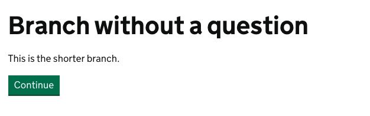
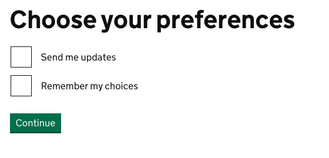
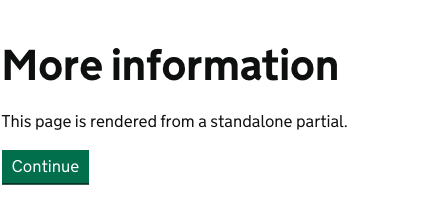

# Building a registration journey

Registration journeys are built in memory by wizard classes. A wizard creates a
`Registrations::JourneyDefinition`, defines `Registrations::StepDefinition`
objects, and adds those steps and their transitions to a DfE Wizard graph. The
journey and step definitions are plain Ruby objects, not database records.

This guide is for developers adding or changing a journey.

## Where to look

- Wizard classes: `app/wizards/registrations/`
- Shared wizard behavior: `app/wizards/registrations/journey_wizard.rb`
- Journey, step, answer, and step-type definitions: `app/wizards/`
- Registration page partials: `app/views/registrations/`
- DfE Wizard integration: `app/wizards/registrations/`
- Example: `app/wizards/registrations/documentation_example_wizard.rb`
- Default branch destination: `Registrations::StepDefinition#default_next_step`
  and `lib/tasks/registration_journeys.rake`

## Visual example

The documentation example journey has one page for each concrete step type
and a small branch. The labels below name the DfE Wizard form class used for each
page:


Build the in-memory graph used by the documentation example with:

```sh
bin/rails registration_journeys:documentation_example
```

It is available at `/registrations/documentation-example/:step_slug`, for
example `/registrations/documentation-example/start` and
`/registrations/documentation-example/choose-a-path`. The app requires a
signed-in user to view registration pages.

| Step type | Demo route |
| --- | --- |
| Plain | `/registrations/documentation-example/start` |
| Radio buttons | `/registrations/documentation-example/choose-a-path` |
| Checkboxes | `/registrations/documentation-example/choose-preferences` |
| Institution choice | `/registrations/documentation-example/choose-workplace` |
| HTML partial | `/registrations/documentation-example/more-information` |
| View component | `/registrations/documentation-example/course-start-date` |
| Check answers | `/registrations/documentation-example/check-answers` |

## Create a wizard

Create a class under `app/wizards/registrations/journeys/` that inherits from
`Registrations::JourneyWizard`. Build a `JourneyDefinition` in `initialize`,
then declare each step and graph transition in `steps_processor`. The protected
`add_node` helper creates the step definition and its DfE Wizard graph node
together. These excerpts use the documentation journey's actual name and first
two steps:

```ruby
module Registrations
  module Journeys
    class DocumentationExampleWizard < JourneyWizard
      SLUG = "documentation-example"

      def initialize(session:, journey_definition: nil, current_step: nil, current_step_params: {}, current_user: nil)
        journey_definition ||= JourneyDefinition.new(
          name: "Registration Journey Documentation Example",
          slug: SLUG,
        )

        super(journey_definition:, session:, current_step:, current_step_params:, current_user:)
      end

      def steps_processor
        @steps_processor ||= DfE::Wizard::StepsProcessor::Graph.draw(self, predicate_caller: state_store) do |graph|
          start = add_node(
            graph,
            name: "Start",
            slug: "start",
            step_class: Registrations::StepDefinitions::Plain,
            texts: [
              { text: "This journey demonstrates the available registration step types.", text_class: "govuk-body" },
            ],
          )

          branch_choice = add_node(
            graph,
            name: "Choose a path",
            slug: "choose-a-path",
            state_store_key: "documentation_path",
            answer_display_name: "Path",
            step_class: Registrations::StepDefinitions::RadioButtons,
            previous_step_slug: start.slug,
            branch_join_step_slug: "choose-workplace",
            answers: [
              { name: "Continue to the checkbox example", value: "checkbox", next_step_slug: "choose-preferences" },
              { name: "Skip to the branch end", value: "skip", next_step_slug: "short-branch" },
            ],
          )

          graph.root start.graph_id
          graph.add_edge from: start.graph_id, to: branch_choice.graph_id
          # Add the remaining step nodes and answer-driven edges here.
        end
      end
    end
  end
end
```

`add_node` adds the step definition to the journey and its form class to the
graph. Pass the DfE Wizard form class as `step_class:`; do not pass a
human-readable type label. Add an explicit edge for the default route, and use
`graph.add_multiple_conditional_edges` when answers select different routes.

Common step attributes include:

| Attribute | Purpose |
| --- | --- |
| `name:` | Heading shown on the page. |
| `slug:` | URL segment for the step. |
| `step_class:` | The `Registrations::StepDefinitions::...` class that defines the step type. |
| `previous_step_slug:` | The step's default predecessor / route connection. |
| `state_store_key:` | Key used to save the submitted value. If omitted, it is derived from the step name. |
| `answer_display_name:` | Label used for the answer on Check Answers. Defaults to a humanized state-store key. |
| `display_on_check_answers:` | Whether the captured answer appears on Check Answers. |
| `redirect_path:` and `redirect_state_store_key:` | Optional redirect after this step, with `:key` substitution from the state store. |

`add_node` also accepts these configuration options:

| Option | Purpose |
| --- | --- |
| `texts:` | Array of hashes passed to `add_text!`, such as `{ text: "A note", text_class: "govuk-hint" }`. |
| `html_partial:` | Partial path used by `Registrations::StepDefinitions::HtmlPartial`. |
| `view_component:` | Component class name used by `Registrations::StepDefinitions::ViewComponent`. |
| `services:` | Array of service configurations, each with `class_name:` and `execute_point:`. |

`answers:` is an array of hashes. Each answer can have `name:`, `value:`, and
`hint:`. Branching and answer-level redirects can also use `next_step_slug:`,
`state_store_key:`, `redirect_path:`, and `redirect_state_store_key:`. The
`value` is what the form submits and what the journey stores; `name` is the
human-readable label.

## Step types

The snippets in this section use the same names, slugs, and answers as the
screenshots. They are taken from
`Registrations::Journeys::DocumentationExampleWizard`.

### `Registrations::StepDefinitions::Plain`

A basic page with no answer input. Use `texts:` for explanatory content; the
page can also act as a branch destination.

```ruby
step = add_node(graph,
  name: "Start",
  slug: "start",
  step_class: Registrations::StepDefinitions::Plain,
  texts: [
    { text: "This journey demonstrates the available registration step types.", text_class: "govuk-body" },
  ],
)
```


The same type is also used as a branch destination:

```ruby
short_branch = add_node(graph,
  name: "Branch without a question",
  slug: "short-branch",
  step_class: Registrations::StepDefinitions::Plain,
  previous_step_slug: branch_choice.slug,
  texts: [
    { text: "This is the shorter branch.", text_class: "govuk-body" },
  ],
)
```



### `Registrations::StepDefinitions::RadioButtons`

Renders configured answers as radio buttons. A participant selects one answer.
Use it for a single value such as provider, funding choice, or a branch decision.

```ruby
branch_choice = add_node(graph,
  name: "Choose a path",
  slug: "choose-a-path",
  state_store_key: "documentation_path",
  answer_display_name: "Path",
  step_class: Registrations::StepDefinitions::RadioButtons,
  previous_step_slug: start.slug,
  branch_join_step_slug: "choose-workplace",
  answers: [
    { name: "Continue to the checkbox example", value: "checkbox", next_step_slug: "choose-preferences" },
    { name: "Skip to the branch end", value: "skip", next_step_slug: "short-branch" },
  ],
)
```

Add a hint to an answer with `hint:`. Pass explanatory copy to `add_node` with
`texts:`.


### `Registrations::StepDefinitions::Checkboxes`

Renders configured answers as checkboxes. By default, participants can select
multiple answers and the state store receives an array of values:

```ruby
add_node(graph,
  name: "Choose your preferences",
  slug: "choose-preferences",
  state_store_key: "documentation_preferences",
  answer_display_name: "Preferences",
  step_class: Registrations::StepDefinitions::Checkboxes,
  previous_step_slug: branch_choice.slug,
  answers: [
    { name: "Send me updates", value: "updates" },
    { name: "Remember my choices", value: "remember" },
  ],
)
```



For a single checkbox answer, such as the consent step in the Excellence in
Reception journey, opt out of multi-select in the step config:

```ruby
config: { checkboxes: { multiple_answers: false } }
```

### `Registrations::StepDefinitions::InstitutionChoice`

Renders the workplace search partial and resolves a saved institution ID to the
institution's name on Check Answers. It normally does not need configured answer
options:

```ruby
add_node(graph,
  name: "Choose your workplace",
  slug: "choose-workplace",
  state_store_key: "institution_id",
  answer_display_name: "Workplace",
  step_class: Registrations::StepDefinitions::InstitutionChoice,
  previous_step_slug: checkboxes.slug,
)
```


### `Registrations::StepDefinitions::HtmlPartial`

Renders a standalone partial instead of a form step. The partial is rendered
with `step_definition`, `wizard_step`, and `form` locals (`form` is `nil` for
this type). The partial name is relative to `app/views` and should not include
the leading underscore or `.html.erb` suffix:

```ruby
step = add_node(graph,
  name: "More information",
  slug: "more-information",
  step_class: Registrations::StepDefinitions::HtmlPartial,
  html_partial: "registrations/documentation_example/more_information",
  previous_step_slug: workplace.slug,
)
```

Create the corresponding file at
`app/views/registrations/documentation_example/_more_information.html.erb`.

The demo partial contains the message and link shown in the screenshot:

```erb
<p class="govuk-body">This page is rendered from a standalone partial.</p>

<%= link_to "Continue",
            step_registration_path(wizard_step.journey_slug, "course-start-date"),
            class: "govuk-button" %>
```



### `Registrations::StepDefinitions::ViewComponent`

Renders a `Registrations::BaseCustomViewComponent` subclass. Configure its
constant name with `view_component:`:

```ruby
step = add_node(graph,
  name: "Choose a course start date",
  slug: "course-start-date",
  state_store_key: "course_cohort_ecf_id",
  answer_display_name: "Course start date",
  step_class: Registrations::StepDefinitions::ViewComponent,
  view_component: "Registrations::CourseStartDateComponent",
  previous_step_slug: information.slug,
)
```

The component is rendered with `wizard_step:` and `form:`. For dynamic answers,
implement `answer_options` as an array of hashes containing `:value` and
`:display_value`. The demo component uses currently registerable course
cohorts, so the dates shown can change as the data changes:

```ruby
def answer_options
  course_cohorts = Course.includes(:course_cohorts)
                         .reception
                         .course_cohorts.registerable
                         .order(:training_starts_at).to_a

  options = course_cohorts[1..].map do |course_cohort|
    {
      value: course_cohort.ecf_id,
      display_value: course_cohort.cohort.name,
    }
  end
  options << { value: "later", display_value: "I want to start at a later date" }

  options
end
```

Its template renders those options as radio buttons under the fieldset legend
shown in the screenshot:

```erb
<div class="govuk-!-padding-top-4">
  <%= @form.govuk_radio_buttons_fieldset("When do you want to start a course?") do %>
    <% answer_options.each do |option| %>
      <%= @form.govuk_radio_button(@wizard_step.answer_field_name, option[:value], label: { text: option[:display_value] }, hint: { text: option[:hint] }) %>
    <% end %>
  <% end %>
</div>
```

The submitted value remains the canonical value saved in the state store. The
matching display value is saved alongside it for Check Answers, so dynamically
loaded options do not need a `Registrations::AnswerOption` object. The base component
also provides `display_value_for(value:)`, which looks up the matching label and
falls back to the submitted value.


### `Registrations::StepDefinitions::CheckAnswers`

Renders the Check Answers summary. It usually comes at the end of the journey
and can run the service that creates the application after the participant
submits:

```ruby
step = add_node(graph,
  name: "Check your answers",
  slug: "check-answers",
  step_class: Registrations::StepDefinitions::CheckAnswers,
  previous_step_slug: course_start.slug,
  texts: [
    { text: "Review the information you have entered.", text_class: "govuk-body" },
  ],
)
```


The screenshot shows sample answers entered during the demo journey. A real
participant's Check Answers page is populated from answers in their session.

## Default routes and branching

Set `previous_step_slug:` to document each step's predecessor and to identify
default routes for builder-backed journeys. In a directly composed Wizard 3
graph, add the corresponding `graph.add_edge` explicitly. For conditional
routes, add each answer destination as a graph edge.

For a branch, configure each answer with its destination, then set the
decision step's `branch_join_step_slug` to the step where those paths rejoin:

```text
                  ┌── "Continue to the checkbox example" ──> [Preferences] ──┐
[Choose a path] ──┤                                               ├──> [Workplace]
                  └── "Skip to the branch end" ──> [Short branch] ──────────┘
```

In the demo wizard, answer destinations and the join are configured on the
decision step. The graph edges are then declared explicitly:

```ruby
branch_choice = add_node(
  graph,
  name: "Choose a path",
  slug: "choose-a-path",
  branch_join_step_slug: "choose-workplace",
  step_class: Registrations::StepDefinitions::RadioButtons,
  answers: [
    { name: "Continue to the checkbox example", value: "checkbox", next_step_slug: "choose-preferences" },
    { name: "Skip to the branch end", value: "skip", next_step_slug: "short-branch" },
  ],
)
graph.add_multiple_conditional_edges(
  from: branch_choice.graph_id,
  branches: [
    { when: -> { state_store[branch_choice.answer_key] == "checkbox" }, then: :choose_preferences, label: "Continue to the checkbox example" },
    { when: -> { state_store[branch_choice.answer_key] == "skip" }, then: :short_branch, label: "Skip to the branch end" },
  ],
)
```

Use step slugs to reference destinations; they do not need to be created first.
Branches can nest, with each decision pointing to its own join. The graph
examples in `lib/tasks/registration_journeys.rake` show both a simple and a
nested branch.

## Services attached to steps

Pass a service configuration to `add_node` when a step needs to invoke a service
as the journey runs:

```ruby
add_node(graph,
  name: "Check eligibility",
  step_class: Registrations::StepDefinitions::Plain,
  services: [
    { class_name: "Registrations::ExampleCourse::FundingEligibility", execute_point: :after_update },
  ],
)
```

The service is initialized with `wizard_step:` and must respond to `call`.
Supported execution points are `:before_show` and `:after_update`. The service
configuration lives on the step, so wizard classes do not need to modify the
controller.

## Rebuilding journeys locally

`Registrations::Courses::JourneyDefinitions` maps each journey slug to its Wizard 3
class. The `registration_journeys:rebuild` task builds the registered journey
graphs for local inspection; it does not write journey definitions to the
database.
