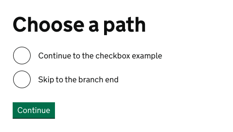
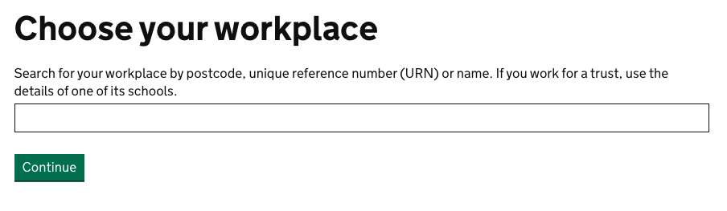
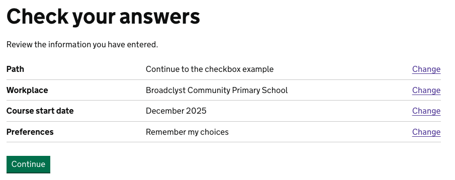

# Building a registration journey

Registration journeys are persisted as a `RegistrationJourney` and a graph of
`RegistrationStep` records. Each step's STI class determines how its
page is rendered and what behaviour it has. Builders define the journey in
Ruby; the router reads those records to move a participant through it.

This guide is for developers adding or changing a journey.

## Where to look

- Journey builders: `app/services/registrations/`
- Shared builder helper: `app/services/registrations/base_registration_journey_builder.rb`
- Step and answer creation: `app/services/registrations/steps/create.rb`
- Step types: `app/models/registration_steps/`
- Registration page partials: `app/views/registrations/`
- Branch navigation: `app/models/registration_steps/branch_traversal/`
- Examples: `app/services/registrations/excellence_in_reception/registration_journey_builder.rb`
  and `lib/tasks/registration_journeys.rake`

## Visual example

The documentation example journey has one page for each concrete step type
and a small branch. The labels below name the STI step class used for each
page:


Build or refresh the local example with:

```sh
bin/rails registration_journeys:documentation_example
```

It is available at `/registrations/documentation-example/:step_slug`, for
example `/registrations/documentation-example/start` and
`/registrations/documentation-example/choose-a-path`. The app requires a
signed-in user to view registration pages.

| Step type | Demo route |
| --- | --- |
| Plain | `/registrations/documentation-example/start` |
| Radio buttons | `/registrations/documentation-example/choose-a-path` |
| Checkboxes | `/registrations/documentation-example/choose-preferences` |
| Institution choice | `/registrations/documentation-example/choose-workplace` |
| HTML partial | `/registrations/documentation-example/more-information` |
| View component | `/registrations/documentation-example/course-start-date` |
| Check answers | `/registrations/documentation-example/check-answers` |

## Create a journey builder

Create a service class under `app/services/registrations/` that inherits from
`Registrations::BaseRegistrationJourneyBuilder`. Create or find the journey in
the initializer, then define its steps in `call` using the protected
`create_step!` helper. This excerpt uses the documentation journey's actual
name and first two steps; the branch destinations are connected later:

```ruby
module Registrations
  module DocumentationExample
    class RegistrationJourneyBuilder < BaseRegistrationJourneyBuilder
      attr_reader :registration_journey

      def initialize
        @registration_journey = ::RegistrationJourney.find_or_create_by!(slug: "documentation-example") do |journey|
          journey.name = "Registration Journey Documentation Example"
        end
      end

      def call
        registration_journey.registration_steps.destroy_all

        start = create_step!(
          name: "Start",
          slug: "start",
          step_class: RegistrationSteps::Plain,
          texts: [
            { text: "This journey demonstrates the available registration step types.", text_class: "govuk-body" },
          ],
        )

        branch_choice = create_step!(
          name: "Choose a path",
          slug: "choose-a-path",
          state_store_key: "documentation_path",
          answer_display_name: "Path",
          step_class: RegistrationSteps::RadioButtons,
          previous_step_id: start.id,
          answers: [
            { name: "Continue to the checkbox example", value: "checkbox" },
            { name: "Skip to the branch end", value: "skip" },
          ],
        )
      end
    end
  end
end
```

`create_step!` delegates to `Registrations::Steps::Create`, which creates the
step and its answer records in one transaction. Pass the STI class as
`step_class:`; do not pass a human-readable type label.

Common step attributes include:

| Attribute | Purpose |
| --- | --- |
| `name:` | Heading shown on the page. |
| `slug:` | URL segment for the step. |
| `step_class:` | The `RegistrationSteps::...` class that defines the step type. |
| `previous_step_id:` | The step's default predecessor / route connection. |
| `state_store_key:` | Key used to save the submitted value. If omitted, it is derived from the step name. |
| `answer_display_name:` | Label used for the answer on Check Answers. Defaults to a humanized state-store key. |
| `display_on_check_answers:` | Whether the captured answer appears on Check Answers. |
| `redirect_path:` and `redirect_state_store_key:` | Optional redirect after this step, with `:key` substitution from the state store. |

The builder helper also accepts these configuration options:

| Option | Purpose |
| --- | --- |
| `texts:` | Array of hashes passed to `add_text!`, such as `{ text: "A note", text_class: "govuk-hint" }`. |
| `html_partial:` | Partial path used by `RegistrationSteps::HtmlPartial`. |
| `view_component:` | Component class name used by `RegistrationSteps::ViewComponent`. |
| `services:` | Array of service configurations, each with `class_name:` and `execute_point:`. |

`answers:` is an array of hashes. Each answer can have `name:`, `value:`, and
`hint:`. Branching and answer-level redirects can also use `next_step_id:`,
`state_store_key:`, `redirect_path:`, and `redirect_state_store_key:`. The
`value` is what the form submits and what the journey stores; `name` is the
human-readable label.

## Step types

The snippets in this section use the same names, slugs, and answers as the
screenshots. They are taken from
`Registrations::DocumentationExample::RegistrationJourneyBuilder`.

### `RegistrationSteps::Plain`

A basic page with no answer input. Use `texts:` for explanatory content; the
page can also act as a branch destination.

```ruby
step = create_step!(
  name: "Start",
  slug: "start",
  step_class: RegistrationSteps::Plain,
  texts: [
    { text: "This journey demonstrates the available registration step types.", text_class: "govuk-body" },
  ],
)
```


The same type is also used as a branch destination:

```ruby
short_branch = create_step!(
  name: "Branch without a question",
  slug: "short-branch",
  step_class: RegistrationSteps::Plain,
  previous_step_id: branch_choice.id,
  texts: [
    { text: "This is the shorter branch.", text_class: "govuk-body" },
  ],
)
```


### `RegistrationSteps::RadioButtons`

Renders configured answers as radio buttons. A participant selects one answer.
Use it for a single value such as provider, funding choice, or a branch decision.

```ruby
branch_choice = create_step!(
  name: "Choose a path",
  slug: "choose-a-path",
  state_store_key: "documentation_path",
  answer_display_name: "Path",
  step_class: RegistrationSteps::RadioButtons,
  previous_step_id: start.id,
  answers: [
    { name: "Continue to the checkbox example", value: "checkbox" },
    { name: "Skip to the branch end", value: "skip" },
  ],
)

# Once the branch destinations and join step have been created, point each
# answer at its destination and configure the join.
branch_choice.set_answers!(
  answers: [
    { name: "Continue to the checkbox example", value: "checkbox", next_step_id: checkboxes.id },
    { name: "Skip to the branch end", value: "skip", next_step_id: short_branch.id },
  ],
)
branch_choice.update!(branch_join_step: workplace)
```

Add a hint to an answer with `hint:`. Pass explanatory copy to `create_step!`
with `texts:`.



### `RegistrationSteps::Checkboxes`

Renders configured answers as checkboxes. By default, participants can select
multiple answers and the state store receives an array of values:

```ruby
create_step!(
  name: "Choose your preferences",
  slug: "choose-preferences",
  state_store_key: "documentation_preferences",
  answer_display_name: "Preferences",
  step_class: RegistrationSteps::Checkboxes,
  previous_step_id: branch_choice.id,
  answers: [
    { name: "Send me updates", value: "updates" },
    { name: "Remember my choices", value: "remember" },
  ],
)
```


For a single checkbox answer, such as the consent step in the Excellence in
Reception journey, opt out of multi-select in the step config:

```ruby
config: { checkboxes: { multiple_answers: false } }
```

### `RegistrationSteps::InstitutionChoice`

Renders the workplace search partial and resolves a saved institution ID to the
institution's name on Check Answers. It normally does not need configured answer
records:

```ruby
create_step!(
  name: "Choose your workplace",
  slug: "choose-workplace",
  state_store_key: "institution_id",
  answer_display_name: "Workplace",
  step_class: RegistrationSteps::InstitutionChoice,
  previous_step_id: checkboxes.id,
)
```



### `RegistrationSteps::HtmlPartial`

Renders a standalone partial instead of a form step. The partial is rendered
with `registration_step`, `router_step`, and `form` locals (`form` is `nil` for
this type). The partial name is relative to `app/views` and should not include
the leading underscore or `.html.erb` suffix:

```ruby
step = create_step!(
  name: "More information",
  slug: "more-information",
  step_class: RegistrationSteps::HtmlPartial,
  html_partial: "registrations/documentation_example/more_information",
  previous_step_id: workplace.id,
)
```

Create the corresponding file at
`app/views/registrations/documentation_example/_more_information.html.erb`.

The demo partial contains the message and link shown in the screenshot:

```erb
<p class="govuk-body">This page is rendered from a standalone partial.</p>

<%= link_to "Continue",
            step_registration_path(router_step.registration_journey_slug, "course-start-date"),
            class: "govuk-button" %>
```


### `RegistrationSteps::ViewComponent`

Renders a `Registrations::BaseCustomViewComponent` subclass. Configure its
constant name after creating the step:

```ruby
step = create_step!(
  name: "Choose a course start date",
  slug: "course-start-date",
  state_store_key: "course_cohort_ecf_id",
  answer_display_name: "Course start date",
  step_class: RegistrationSteps::ViewComponent,
  view_component: "Registrations::CourseStartDateComponent",
  previous_step_id: information.id,
)
```

The component is rendered with `router_step:` and `form:`. For dynamic answers,
implement `answer_options` as an array of hashes containing `:value` and
`:display_value`. The demo component uses currently registerable course
cohorts, so the dates shown can change as the data changes:

```ruby
def answer_options
  course_cohorts = Course.includes(:course_cohorts)
                         .reception
                         .course_cohorts.registerable
                         .order(:training_starts_at).to_a

  options = course_cohorts[1..].map do |course_cohort|
    {
      value: course_cohort.ecf_id,
      display_value: course_cohort.cohort.name,
    }
  end
  options << { value: "later", display_value: "I want to start at a later date" }

  options
end
```

Its template renders those options as radio buttons under the fieldset legend
shown in the screenshot:

```erb
<div class="govuk-!-padding-top-4">
  <%= @form.govuk_radio_buttons_fieldset("When do you want to start a course?") do %>
    <% answer_options.each do |option| %>
      <%= @form.govuk_radio_button(:step_answer, option[:value], label: { text: option[:display_value] }, hint: { text: option[:hint] }) %>
    <% end %>
  <% end %>
</div>
```

The submitted value remains the canonical value saved in the state store. The
matching display value is saved alongside it for Check Answers, so dynamically
loaded options do not need a `RegistrationStepAnswer` record. The base component
also provides `display_value_for(value:)`, which looks up the matching label and
falls back to the submitted value.


### `RegistrationSteps::CheckAnswers`

Renders the Check Answers summary. It usually comes at the end of the journey
and can run the service that creates the application after the participant
submits:

```ruby
step = create_step!(
  name: "Check your answers",
  slug: "check-answers",
  step_class: RegistrationSteps::CheckAnswers,
  previous_step_id: course_start.id,
  texts: [
    { text: "Review the information you have entered.", text_class: "govuk-body" },
  ],
)
```



The screenshot shows sample answers entered during the demo journey. A real
participant's Check Answers page is populated from answers in their session.

## Default routes and branching

For a linear journey, connect each step to its predecessor with
`previous_step_id:`. If an answer has no `next_step_id`, the router follows the
step's configured default route.

For a branch, configure every answer with its destination, then set the
decision step's `branch_join_step_id` to the step where those paths rejoin:

```text
                  ┌── "Continue to the checkbox example" ──> [Preferences] ──┐
[Choose a path] ──┤                                               ├──> [Workplace]
                  └── "Skip to the branch end" ──> [Short branch] ──────────┘
```

In the demo builder, answer destinations are assigned after the branch steps
and join have been created:

```ruby
branch_choice.set_answers!(
  answers: [
    {
      name: "Continue to the checkbox example",
      value: "checkbox",
      next_step_id: checkboxes.id,
    },
    {
      name: "Skip to the branch end",
      value: "skip",
      next_step_id: short_branch.id,
    },
  ],
)
branch_choice.update!(branch_join_step: workplace)
```

Create the destination and join steps before assigning their IDs. A step with a
`branch_join_step` must have answers and every answer must have a
`next_step_id`; the model validates this. Branches can nest, with each decision
pointing to its own join. The branching examples in `lib/tasks/registration_journeys.rake`
show both a simple and a nested branch.

## Services attached to steps

Pass a service configuration to `create_step!` when a step needs to invoke a
service as the journey runs:

```ruby
create_step!(
  name: "Check eligibility",
  step_class: RegistrationSteps::Plain,
  services: [
    { class_name: "Registrations::ExampleCourse::FundingEligibility", execute_point: :after_update },
  ],
)
```

The service is initialized with `router_step:` and must respond to `call`.
Supported execution points are `:before_show` and `:after_update`. The service
configuration lives on the step, so builders do not need to modify the
controller.

## Rebuilding journeys locally

The builders are invoked by `bin/rails registration_journeys:rebuild`. That task
deletes all existing registration journeys before rebuilding the configured
ones, so it is destructive to journey data in the selected database. Add a new
builder to the task's `service_classes` list if it should be included in that
rebuild.
