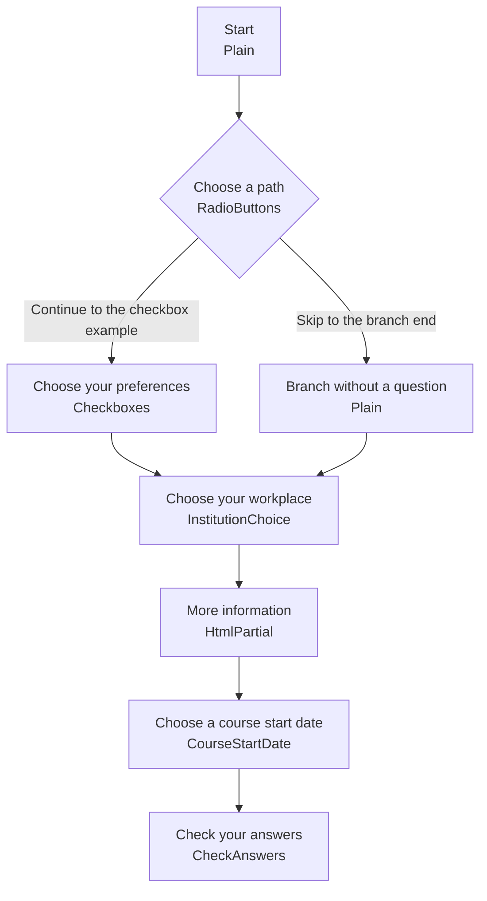
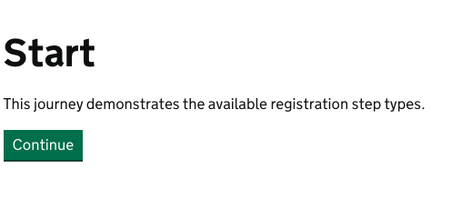
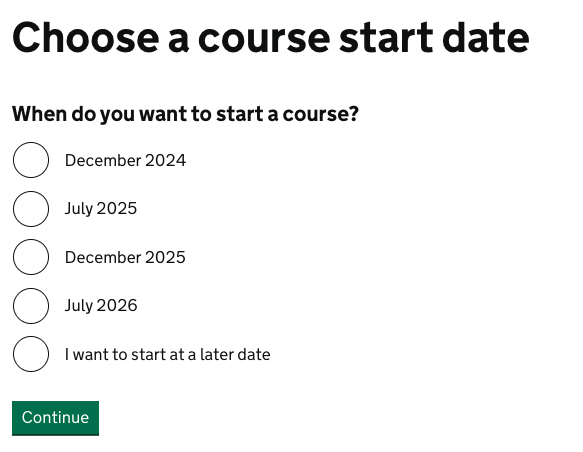

# Building a registration journey

Registration journeys are built in memory by wizard classes. Most currently
create `Registrations::StepDefinition` objects and add them to a DfE Wizard
graph. The Course Selection wizard is a direct DfE Wizard implementation: its
step classes declare their own fields and its graph explicitly registers those
classes. Both approaches use plain Ruby objects rather than database records.

This guide is for developers adding or changing a journey.

## Where to look

- Wizard classes: `app/wizards/registrations/`
- Shared wizard behavior: `app/wizards/registrations/base_journey_wizard.rb`
- Journey, step, answer, and step-type definitions: `app/wizards/registrations/`
- Registration page partials: `app/views/registrations/`
- DfE Wizard integration: `app/wizards/registrations/`
- Example: `app/wizards/registrations/documentation_example_wizard.rb`
- Default routes and branches: each wizard's `steps_processor` graph

## Direct DfE Wizard example

`CourseSelectionWizard` shows the direct approach. Its graph uses
`graph.add_node` with concrete `DfE::Wizard::Step` classes and declares the
transition with `graph.add_edge`. It reuses the HTML-partial and radio-button
step classes, with question and answer data in `STEP_CONFIG`, keyed by graph
node ID. The runtime step gets its configuration from its DfE Wizard `step_id`.

The steps are in `app/wizards/registrations/journeys/course_selection/`:

- `Start` declares the `self_funded` field and renders the start partial.
- `Courses` declares `course_journey_slug`, validates it, builds its options
  from available courses, and redirects to the selected course journey.

This path does not create `StepDefinition` objects. Other journey builders
still use the shared `add_node` helper described below.

`Registrations::JourneyStepTypes` contains reusable DfE Wizard steps such as
`RadioButtons`, `HtmlPartial`, `CourseStartDate`, and `CheckAnswers`. A configured
radio step submits the shared `answer` field; the runtime step saves that value
under the `answer_key` from `STEP_CONFIG`. This lets several graph nodes use
the same DfE step class without a Ruby class per question.

`CourseOneWizard` also composes `SharedFavouritePetAndSportJourneyWizard` by
calling its `add_to_graph` method with explicit `after:` and `before:` node IDs.
The shared journey registers reusable radio-button and HTML-partial DfE Wizard
step classes on the same graph. `CourseOneWizard::STEP_CONFIG` combines the
course's question data with the shared journey's config. Course-specific
services remain explicit in the wizard's `execute_services` method.

## Visual example

The documentation example journey has one page for each concrete step type
and a small branch. The labels below name the DfE Wizard form class used for each
page:



The factory builds this in-memory graph when the documentation journey is
requested. It is available at `/registrations/documentation-example/:step_slug`,
for example `/registrations/documentation-example/start` and
`/registrations/documentation-example/choose-a-path`. The app requires a
signed-in user to view registration pages.

| Step type | Demo route |
| --- | --- |
| Plain | `/registrations/documentation-example/start` |
| Radio buttons | `/registrations/documentation-example/choose-a-path` |
| Checkboxes | `/registrations/documentation-example/choose-preferences` |
| Institution choice | `/registrations/documentation-example/choose-workplace` |
| HTML partial | `/registrations/documentation-example/more-information` |
| Course start date | `/registrations/documentation-example/course-start-date` |
| Check answers | `/registrations/documentation-example/check-answers` |

## Create a wizard

Create a class under `app/wizards/registrations/journeys/` that inherits from
`Registrations::BaseJourneyWizard`. Build a `JourneyDefinition` in `initialize`,
then declare each step and graph transition in `steps_processor`. The protected
`add_node` helper creates the step definition and its DfE Wizard graph node
together. These excerpts use the documentation journey's actual name and first
two steps:

```ruby
module Registrations
  module Journeys
    class DocumentationExampleWizard < BaseJourneyWizard
      SLUG = "documentation-example"

      def initialize(session:, journey_definition: nil, current_step: nil, current_step_params: {}, current_user: nil)
        journey_definition ||= JourneyDefinition.new(
          name: "Registration Journey Documentation Example",
          slug: SLUG,
        )

        super(journey_definition:, session:, current_step:, current_step_params:, current_user:)
      end

      def steps_processor
        @steps_processor ||= DfE::Wizard::StepsProcessor::Graph.draw(self, predicate_caller: state_store) do |graph|
          add_node(
            graph,
            name: "Start",
            slug: "start",
            step_class: Registrations::StepDefinitions::Plain,
            texts: [
              { text: "This journey demonstrates the available registration step types.", text_class: "govuk-body" },
            ],
          )

          add_node(
            graph,
            name: "Choose a path",
            slug: "choose-a-path",
            state_store_key: "documentation_path",
            answer_display_name: "Path",
            step_class: Registrations::StepDefinitions::RadioButtons,
            answers: [
              { name: "Continue to the checkbox example", value: "checkbox", next_step_slug: "choose-preferences" },
              { name: "Skip to the branch end", value: "skip", next_step_slug: "short-branch" },
            ],
          )

          graph.root :start
          graph.add_edge from: :start, to: :choose_a_path
          # Add the remaining step nodes and answer-driven edges here.
        end
      end
    end
  end
end
```

`add_node` adds the step definition to the journey and registers a node in the
graph. The node's ID is its underscored slug symbol. Pass the DfE Wizard form class as `step_class:`; do not pass a
human-readable type label. Add an explicit edge for the default route, and use
`graph.add_multiple_conditional_edges` when answers select different routes.

Common step attributes include:

| Attribute | Purpose |
| --- | --- |
| `name:` | Heading shown on the page. |
| `slug:` | URL segment for the step. |
| `step_class:` | The `Registrations::StepDefinitions::...` class that defines the step type. |
| `state_store_key:` | Key used to save the submitted value. If omitted, it is derived from the step name. |
| `answer_display_name:` | Label used for the answer on Check Answers. Defaults to a humanized state-store key. |
| `display_on_check_answers:` | Whether the captured answer appears on Check Answers. |
| `redirect_path:` and `redirect_state_store_key:` | Optional redirect after this step, with `:key` substitution from the state store. |

`add_node` also accepts these configuration options:

| Option | Purpose |
| --- | --- |
| `texts:` | Array of hashes passed to `add_text!`, such as `{ text: "A note", text_class: "govuk-hint" }`. |
| `html_partial:` | Partial path used by `Registrations::StepDefinitions::HtmlPartial`. |
| `services:` | Array of service configurations, each with `class_name:` and `execute_point:`. |

`answers:` is an array of hashes. Each answer can have `name:`, `value:`, and
`hint:`. Branching and answer-level redirects can also use `next_step_slug:`,
`state_store_key:`, `redirect_path:`, and `redirect_state_store_key:`. The
`value` is what the form submits and what the journey stores; `name` is the
human-readable label.

## Step types

The snippets in this section use the same names, slugs, and answers as the
screenshots. They are taken from
`Registrations::Journeys::DocumentationExampleWizard`.

### `Registrations::StepDefinitions::Plain`

A basic page with no answer input. Use `texts:` for explanatory content; the
page can also act as a branch destination.

```ruby
step = add_node(graph,
  name: "Start",
  slug: "start",
  step_class: Registrations::StepDefinitions::Plain,
  texts: [
    { text: "This journey demonstrates the available registration step types.", text_class: "govuk-body" },
  ],
)
```



The same type is also used as a branch destination:

```ruby
short_branch = add_node(graph,
  name: "Branch without a question",
  slug: "short-branch",
  step_class: Registrations::StepDefinitions::Plain,
  texts: [
    { text: "This is the shorter branch.", text_class: "govuk-body" },
  ],
)
```


### `Registrations::StepDefinitions::RadioButtons`

Renders configured answers as radio buttons. A participant selects one answer.
Use it for a single value such as provider, funding choice, or a branch decision.

```ruby
branch_choice = add_node(graph,
  name: "Choose a path",
  slug: "choose-a-path",
  state_store_key: "documentation_path",
  answer_display_name: "Path",
  step_class: Registrations::StepDefinitions::RadioButtons,
  answers: [
    { name: "Continue to the checkbox example", value: "checkbox", next_step_slug: "choose-preferences" },
    { name: "Skip to the branch end", value: "skip", next_step_slug: "short-branch" },
  ],
)
```

Add a hint to an answer with `hint:`. Pass explanatory copy to `add_node` with
`texts:`.


### `Registrations::StepDefinitions::Checkboxes`

Renders configured answers as checkboxes. By default, participants can select
multiple answers and the state store receives an array of values:

```ruby
add_node(graph,
  name: "Choose your preferences",
  slug: "choose-preferences",
  state_store_key: "documentation_preferences",
  answer_display_name: "Preferences",
  step_class: Registrations::StepDefinitions::Checkboxes,
  answers: [
    { name: "Send me updates", value: "updates" },
    { name: "Remember my choices", value: "remember" },
  ],
)
```


For a single checkbox answer, such as the consent step in the Excellence in
Reception journey, opt out of multi-select in the step config:

```ruby
config: { checkboxes: { multiple_answers: false } }
```

### `Registrations::StepDefinitions::InstitutionChoice`

Renders the workplace search partial and resolves a saved institution ID to the
institution's name on Check Answers. It normally does not need configured answer
options:

```ruby
add_node(graph,
  name: "Choose your workplace",
  slug: "choose-workplace",
  state_store_key: "institution_id",
  answer_display_name: "Workplace",
  step_class: Registrations::StepDefinitions::InstitutionChoice,
)
```


### `Registrations::StepDefinitions::HtmlPartial`

Renders a standalone partial instead of a form step. The partial is rendered
with `step`, `wizard_step`, and `form` locals (`form` is `nil` for this type).
The partial name is relative to `app/views` and should not include
the leading underscore or `.html.erb` suffix:

```ruby
step = add_node(graph,
  name: "More information",
  slug: "more-information",
  step_class: Registrations::StepDefinitions::HtmlPartial,
  html_partial: "registrations/documentation_example/more_information",
)
```

Create the corresponding file at
`app/views/registrations/documentation_example/_more_information.html.erb`.

The demo partial contains the message and link shown in the screenshot:

```erb
<p class="govuk-body">This page is rendered from a standalone partial.</p>

<%= link_to "Continue",
            step_registration_path(wizard_step.journey_slug, "course-start-date"),
            class: "govuk-button" %>
```


### Dynamic radio options and funding result screens

`JourneyStepTypes::CourseStartDate` is a DfE Wizard step class that builds its
radio options from the current course's registerable cohorts. Its ERB partial,
`app/views/registrations/_course_start_date.html.erb`, renders those options.
The selected cohort ID remains the submitted value; the friendly cohort label
is captured with the session data for Check Answers.

Funding result steps use a regular step class and the
`app/views/registrations/_funding_eligibility_result.html.erb` partial. The
partial reads the result code from the step's state store and renders the
appropriate content. Shared funding journeys can use the same partial without
a custom component base class.



### `Registrations::StepDefinitions::CheckAnswers`

Renders the Check Answers summary. It usually comes at the end of the journey
and can run the service that creates the application after the participant
submits:

```ruby
step = add_node(graph,
  name: "Check your answers",
  slug: "check-answers",
  step_class: Registrations::StepDefinitions::CheckAnswers,
  texts: [
    { text: "Review the information you have entered.", text_class: "govuk-body" },
  ],
)
```


The screenshot shows sample answers entered during the demo journey. A real
participant's Check Answers page is populated from answers in their session.

## Default routes and branching

Declare all routes in the DfE Wizard graph. Use `graph.add_edge` for a direct
transition and `graph.add_multiple_conditional_edges` when a step has several
possible destinations. The graph is the source of truth for both forward and
back navigation.

For a branch, configure each answer with its destination and connect each path
to the shared next step:

```text
                  ┌── "Continue to the checkbox example" ──> [Preferences] ──┐
[Choose a path] ──┤                                               ├──> [Workplace]
                  └── "Skip to the branch end" ──> [Short branch] ──────────┘
```

In the demo wizard, the answer options define the submitted values. The graph
declares the transitions separately with explicit node symbols:

```ruby
add_node(
  graph,
  name: "Choose a path",
  slug: "choose-a-path",
  step_class: Registrations::StepDefinitions::RadioButtons,
  answers: [
    { name: "Continue to the checkbox example", value: "checkbox", next_step_slug: "choose-preferences" },
    { name: "Skip to the branch end", value: "skip", next_step_slug: "short-branch" },
  ],
)
graph.add_multiple_conditional_edges(
  from: :choose_a_path,
  branches: [
    { when: -> { state_store["documentation_path"] == "checkbox" }, then: :choose_preferences, label: "Continue to the checkbox example" },
    { when: -> { state_store["documentation_path"] == "skip" }, then: :short_branch, label: "Skip to the branch end" },
  ],
)
```

Use the underscored slug symbol for each graph node. Branches can nest, with
each path connected explicitly to its next step. The
`Registrations::Journeys::ExcellenceInReceptionWizard` graph is an example of
a production journey with multiple branching decisions.

## Services attached to steps

Pass a service configuration to `add_node` when a step needs to invoke a service
as the journey runs:

```ruby
add_node(graph,
  name: "Check eligibility",
  step_class: Registrations::StepDefinitions::Plain,
  services: [
    { class_name: "Registrations::ExampleCourse::FundingEligibility", execute_point: :after_update },
  ],
)
```

The service is initialized with `wizard_step:` and must respond to `call`.
Supported execution points are `:before_show` and `:after_update`. The service
configuration lives on the step, so wizard classes do not need to modify the
controller.

## Finding the wizard for a route

`Registrations::JourneyWizardFactory` maps course identifiers and the
documentation journey slug to wizard classes. Course identifiers map to
`Course` records, which are passed to the wizard. The graph is built in memory
when the request constructs the wizard; journey definitions are not stored in
the database.
